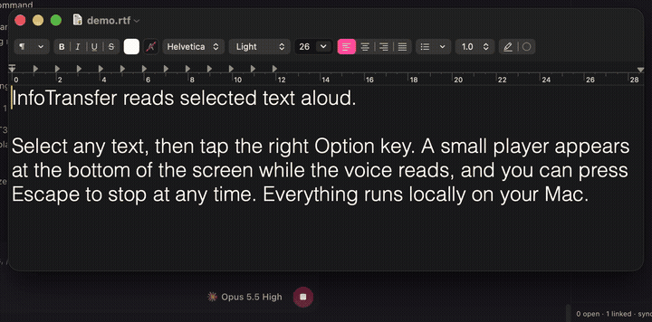
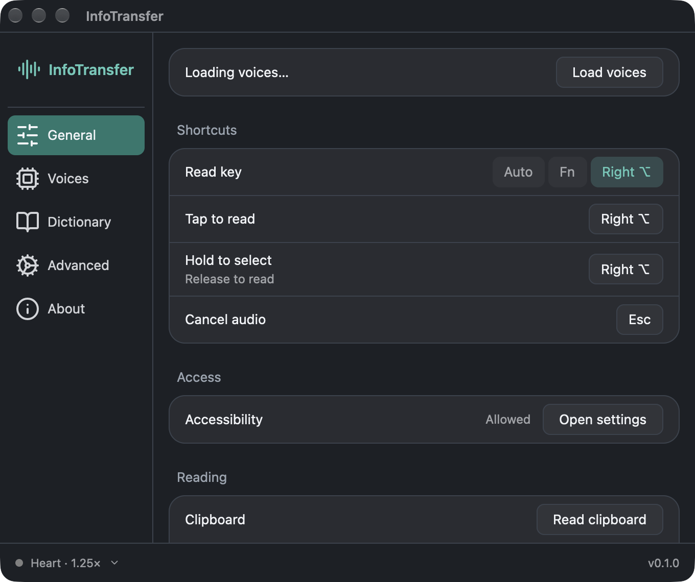
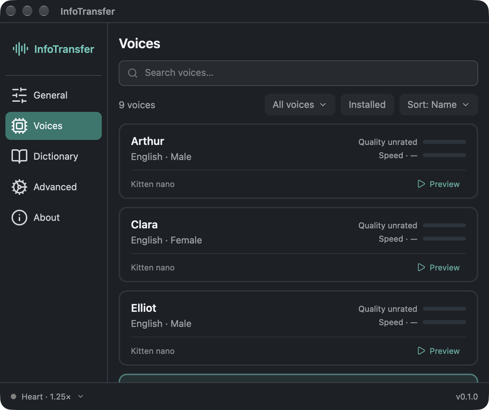
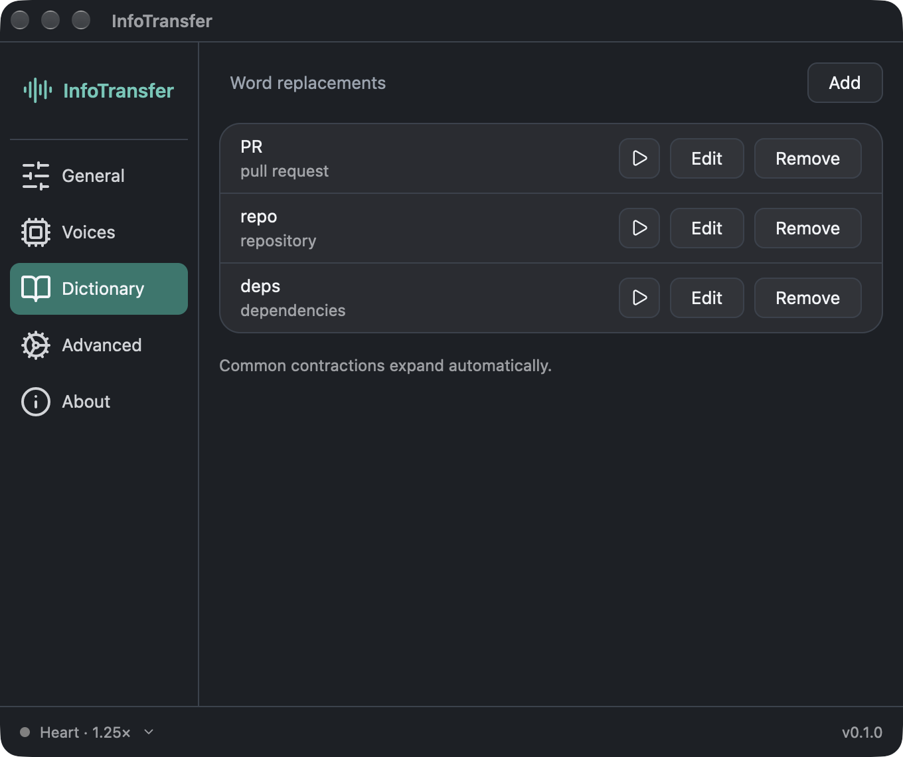
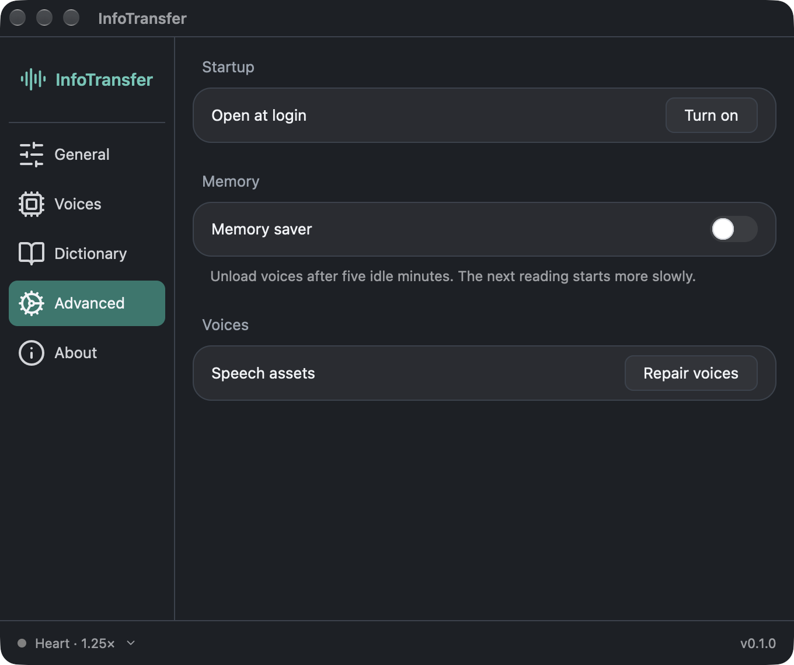

<p align="center">
  
</p>

<h1 align="center">InfoTransfer</h1>

<p align="center">
  <strong>Select text anywhere on your Mac. Tap one key. Hear it read aloud.</strong><br>
  A local, private text-to-speech reader for people with dyslexia, low vision, reading fatigue,
  or anyone who understands better by listening.
</p>

<p align="center">
  
  
  
  
  
  <br>
  
  
  
</p>

<p align="center">
  
</p>

<p align="center"><sub>Select text → tap right Option → listen. Press Esc to stop. <a href="docs/media/usage.mp4">MP4 version</a> (the recording has no sound).</sub></p>

## Who it is for

Reading a wall of text can be slow and tiring. Letters swap places, lines blur together, and you lose your place. Listening while you follow along makes text easier to take in.

InfoTransfer is built for:

- **People with dyslexia** and other reading differences. Hear any paragraph while you follow along on screen.
- **People with low vision or eye strain.** Rest your eyes and listen instead.
- **People with ADHD or reading fatigue.** Listening helps you stay on long emails, articles and documents.
- **People who find the computer hard to use.** One key does everything. There are no menus to learn and no app to switch to.
- **Language learners**, who can hear how a sentence is pronounced.

It is designed to stay out of the way:

- One key to read, one key to stop.
- A small player in the middle of the bottom of the screen shows when it is getting ready, when it is reading, and what went wrong if it cannot read.
- Large, high-contrast controls and short, plain labels.
- The speed and the pause between sentences are adjustable.
- A personal dictionary fixes words and names that are read wrongly.
- Code, numbers and symbols are read sensibly. For example, `3.5 GB` is read as "three point five gigabytes", and symbols such as `---` are skipped.
- **Private:** speech is generated on your Mac. Your text never leaves the computer, and there is no account, tracking or subscription.

## How to use it

| Do this | What happens |
| --- | --- |
| Select text, then **tap right Option** (or **Fn**) | The selected text is read aloud. |
| **Hold** the key, select text with the mouse, then **release** | The new selection is read when you let go. |
| Press **Esc** | Reading stops. |
| Click the menu bar icon | Read clipboard, pause or resume, stop, settings, quit. |

It works in apps that share their text with macOS Accessibility. It has been tested in TextEdit, Preview (PDFs) and Zen, a Firefox-based browser. If an app hides its text, such as a password field, the player explains why and you can copy the text and choose **Read clipboard** instead.

You can choose the key in **Settings → General**: Fn, right Option, or Auto.

## Screenshots

<table>
  <tr>
    <td></td>
    <td></td>
  </tr>
  <tr>
    <td align="center"><sub>General: key, permissions, speed</sub></td>
    <td align="center"><sub>Voices: pick and preview a voice</sub></td>
  </tr>
  <tr>
    <td></td>
    <td></td>
  </tr>
  <tr>
    <td align="center"><sub>Dictionary: fix how words are read</sub></td>
    <td align="center"><sub>Advanced: open at login, memory saver</sub></td>
  </tr>
</table>

## Voices

InfoTransfer reads with one voice for now: **Heart**, from [Paradee](https://github.com/sahilmahendrakar/paradee) v1.2, a small model distilled from Kokoro's Heart voice. The model prepares a sentence in about 0.1 s on an M4. Light cleanup EQ removes rumble, softens harsh "s" sounds and quiets hiss between words.

The voice is downloaded once (about 21 MB) from pinned, checksum-verified sources, and then works fully offline.

## Install

You need a Mac with Apple Silicon (M1 or newer) running macOS 14 Sonoma or later.

### Quick install (prebuilt, unsigned)

```sh
curl -fsSL https://github.com/sxxrfx/infotransfer/releases/latest/download/install.sh | sh
```

> [!WARNING]
> **This is an unsigned app.** InfoTransfer is not signed with an Apple Developer ID and is not notarized by Apple, so macOS has not checked it. The script shows this warning and asks before installing. It verifies the download's SHA256 checksum, installs the app to `/Applications` and opens it.
>
> **Building from source (below) is more secure**, because you can read the code you run and you don't have to trust a prebuilt binary.

If you download the zip from [Releases](https://github.com/sxxrfx/infotransfer/releases) in a browser instead, macOS refuses to open it. Move the app to Applications, then run `xattr -dr com.apple.quarantine /Applications/InfoTransfer.app`, or click **Open Anyway** in System Settings → Privacy & Security.

<details>
<summary>Why is it unsigned, and what does that change?</summary>

Apple only notarizes apps from paid developer accounts. When you download an app in a browser, macOS marks it as "quarantined", and Gatekeeper refuses to open a quarantined app that Apple has not notarized. `curl` does not add the quarantine mark, so the install script avoids the warning. Removing the mark with `xattr` has the same effect for that one app. It does not turn off Gatekeeper for anything else.

Each release is signed with the same self-signed certificate, so macOS keeps your Accessibility permission when you update.
</details>

### Build from source

The steps below take about 10 minutes on a fresh Mac. **You do not need an Apple developer account.**

#### Requirements

- Xcode Command Line Tools: `xcode-select --install`
- Rust, installed from [rustup.rs](https://rustup.rs). The pinned toolchain installs automatically.
- Python 3 and git. Both come with the Command Line Tools.

#### Build and install

```sh
git clone https://github.com/sxxrfx/infotransfer.git
cd infotransfer

python3 scripts/prepare_runtime.py         # once: ONNX Runtime (from the sherpa-onnx release), checksum-verified
python3 scripts/prepare_pronunciation.py   # once: offline pronunciation helper, built from source
python3 scripts/local_signing.py --setup   # once: a private signing identity for your Mac
python3 scripts/package_app.py --install   # build and copy InfoTransfer.app to /Applications
```

`local_signing.py` creates a self-signed certificate in a separate keychain under `~/Library/Application Support/InfoTransfer/signing`. It does not change system trust settings. It means that macOS keeps your Accessibility permission each time you rebuild.

### First launch

1. Open **InfoTransfer** from Applications. A speaker icon appears in the menu bar and the settings window opens.
2. Click **Download voices**.
3. Allow Accessibility access, which InfoTransfer needs to read the text you select:
   - Click **Open settings** next to Accessibility.
   - In **System Settings → Privacy & Security → Accessibility**, turn **InfoTransfer** on.
   - If an older InfoTransfer entry is listed, remove it with the **−** button first.
4. Select some text in any app and tap **right Option**.

Optional: turn on **Settings → Advanced → Open at login**.

### Update

The prebuilt app updates itself. It checks GitHub Releases once a day (turn this off in **Settings → About**). When a new version is available, a short notice appears; click **Install and restart** in **Settings → About**.

Each update is checked before it is installed:

- The release information is signed with the project's Ed25519 key, and the app accepts only a newer version with a valid signature.
- The download must match the signed size and SHA-256.
- The new app must be signed by the same identity as the copy you have. This also keeps your Accessibility permission.

A copy you built from source has your own signing identity, so it never installs prebuilt updates. Update it by rebuilding:

```sh
git pull
python3 scripts/package_app.py --install
```

Quit InfoTransfer from the menu bar before packaging. The packager refuses to replace a running app.

### Uninstall

Quit InfoTransfer, then delete:

- `/Applications/InfoTransfer.app`
- `~/Library/Application Support/InfoTransfer`

Also remove its entry in **System Settings → Privacy & Security → Accessibility**.

## Troubleshooting

| Problem | Fix |
| --- | --- |
| Nothing happens when I tap the key | Check that Accessibility is **Allowed** in Settings → General. Try right Option if Fn is used by dictation or the emoji picker. |
| "No text selected" | Some apps do not share their selection. Copy the text and use **Read clipboard** from the menu bar. |
| "Protected field" | Password and secure fields cannot be read, by design. |
| The first reading is slow | The first reading loads the voice. Later readings start quickly. |
| A word is pronounced wrongly | Add it in **Settings → Dictionary**. |
| Packaging hangs on codesign | Run `python3 scripts/local_signing.py --setup` again. It uses its own keychain, so codesign does not wait on a Keychain prompt. |

## Development

```sh
cargo test
cargo clippy --all-targets --all-features -- -D warnings
cargo fmt --check
cargo run --release --features visual-test --bin render-check
```

- `package_app.py --ui-preview` builds an ad-hoc preview at `.cache/ui-preview/InfoTransfer.app`. This build loses Accessibility access each time you rebuild.
- `release.py` publishes a release: the zip, the install script and a signed `latest.json` for the updater. Bump `version` in `Cargo.toml` and commit first; it refuses uncommitted changes and an already published version. It signs with the Ed25519 update key from the login keychain (or the file in `INFOTRANSFER_UPDATE_KEY`). Store a key file there once with `python3 scripts/release.py --import-key <file>`, keep an offline backup, and delete the file: the update key must not sit next to the code-signing keychain, or one stolen backup could ship a different app. Installed copies only accept updates signed with this key. To create a new key, run `cargo run --release --bin update-sign -- keygen <file>` and put the printed public key in `resources/update-public-key.txt`.
- The pronunciation helper bundles a separate eSpeak NG executable under GPL-3.0-or-later, with its license and full source. See [speech notices](resources/SPEECH-NOTICES.txt).

Further documentation:

- [Specification](docs/SPEC.md)
- [Implementation and measurement notes](docs/IMPLEMENTATION.md)
- [Decision record](docs/decision-tree.md)
- [Feasibility research](docs/research.md)
- [Voice notes](docs/voices.md)

## Roadmap

- A notarized download, so no security warning appears.
- Optional reading history, kept private on your Mac.
- Highlighting each word as it is read.

## Acknowledgements

InfoTransfer was inspired by **[Handy](https://github.com/cjpais/Handy)** by **[CJ Pais](https://github.com/cjpais)**. Handy is a free, open-source, offline speech-to-text app. It showed that a private, local voice tool can be simple, fast and pleasant to use. InfoTransfer is the other direction, text to speech, and its settings layout, navigation and motion were modeled on Handy's design. Thank you, CJ, for building Handy in the open under the MIT license. If you need speech-to-text, try Handy.

InfoTransfer also builds on:

- [ONNX Runtime](https://onnxruntime.ai), from the [sherpa-onnx](https://github.com/k2-fsa/sherpa-onnx) release, for running the speech model.
- The [Paradee](https://github.com/sahilmahendrakar/paradee) Heart voice, distilled from [Kokoro](https://huggingface.co/hexgrad/Kokoro-82M).
- [eSpeak NG](https://github.com/espeak-ng/espeak-ng) for pronouncing new words.
- [GPUI](https://github.com/zed-industries/zed) from Zed Industries.
- [Lucide](https://lucide.dev) icons.

Full notices are in [NOTICE](NOTICE) and [speech notices](resources/SPEECH-NOTICES.txt).

## License

[Apache-2.0](LICENSE). The bundled eSpeak NG pronunciation helper is GPL-3.0-or-later and is shipped as a separate program with its source.
